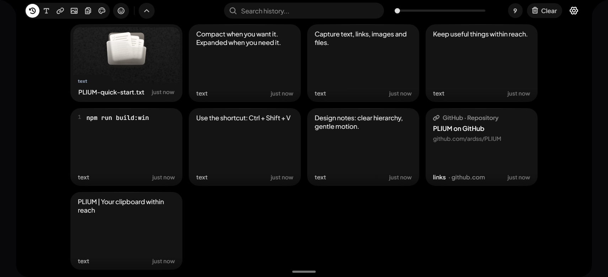
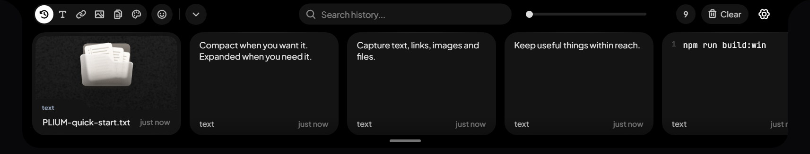
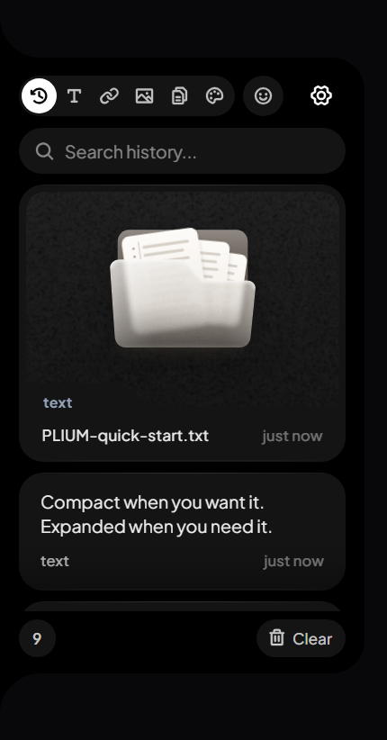

<p align="center"></p>
<h1 align="center">PLIUM · 叠间</h1>
<p align="center"><b>A compact clipboard shelf at the edge of your Windows desktop.</b><br>在屏幕边缘呼出、检索、整理、拖出，而不打断当前工作。</p>

> **Independent open-source fork.** PLIUM is developed from [Edge-Drop](https://github.com/Deepender25/Edge-Drop) (Apache-2.0). It is **not** Edge-Drop's official application, Microsoft Store edition, website or update channel. See [Attribution](#attribution).

## Actual PLIUM interface

<p align="center">
  
</p>

<p align="center"><em>Expanded top Dock ? three rows</em></p>

<p align="center">
  
  
</p>

<sub>All three images were captured from the actual PLIUM 0.4.0-plium.9 Electron application running on Windows B with an isolated profile and synthetic demo clipboard data. They are not upstream Edge-Drop images, renders or mockups, and contain no real user clipboard history.</sub>

## Features

- **Edge shelf** that appears at the screen edge and gets out of your way.
- **Two-state top Dock:** one compact row ↔ three expanded rows; scroll slider and start/end navigation.
- **Clipboard history** for text, URLs, images and files; pinned and noted records are protected from bulk clearing.
- **Drag-out** text into supported external inputs and file/image objects through native Windows drag-and-drop.
- **Search, filter and safe clear:** filtered scopes are shown explicitly before a second confirmation, with a precise deletion count.
- **Tray and keyboard** access, subtle card reflow, shared context-menu design, 31 interface languages.

PLIUM runs on Windows 10/11 x64. Not every third-party app accepts every drop format, and multi-monitor behavior depends on Windows display configuration.

## Preview status and downloads

**The first independent PLIUM `v1.0.0` Windows release is published:** [PLIUM Releases](https://github.com/ardss/PLIUM/releases/tag/v1.0.0) · [release notes](docs/RELEASE-NOTES-v1.0.0.md).

Verified before publishing: 93 test files / 967 tests, 967-case Vitest suite, Electron-Vite build, production dependency audit (0 vulnerabilities), Gitleaks over 339 commits, and a real upgrade on the maintainer's dual-monitor Windows A machine — installer and executable hashes match, single main instance, `items.json` byte-identical across the upgrade (`payloads` 55 / `images` 60 preserved), unique autostart entry, correct multi-monitor top-edge trigger, and tray left/right/double-click plus `Alt+C` all matching the hover-expanded panel pixel-for-pixel.

**Still not re-verified on Windows A:** real drag-out into third-party apps (text/image/file), the clear-confirmation flow, an actual rollback drill, and cold-start-after-logon. These paths are covered by automation and isolated-environment tests but are not claimed as real-device accepted. See [release gates](docs/RELEASE-STATUS.md) for the exact split.

**Online auto-update remains off.** Check the releases page and install manually.

**Unsigned installer warning:** This release is not code-signed, by maintainer decision. Windows may show an **Unknown Publisher** or Microsoft Defender **SmartScreen** warning. Obtain releases only from the [official GitHub repository](https://github.com/ardss/PLIUM/releases), compare the published SHA-256, and decide whether to install. This project does not claim Microsoft certification. Do not disable security protections to install.

See the [current release gates and risk register](docs/RELEASE-STATUS.md). **Do not use upstream Edge-Drop installers to update PLIUM.**

## Build from source

Requires Windows x64, Node.js 22+ and npm.

```powershell
git clone https://github.com/ardss/PLIUM.git
cd PLIUM
npm ci
npm run typecheck
npm test
npm run build:win
```

The unsigned local installer is built under `dist/`. For development use `npm run dev`. Verify downloaded or locally built binaries and back up your data before installation; do not run PLIUM and another clipboard watcher side by side on a production session.

## Identity, privacy and migrations

PLIUM uses `PLIUM.exe`, AppID `com.ardss.plium` and a separate profile under `%APPDATA%\plium`. It never uses the upstream's online updater, store listing or installer identity. Historical Edge-Drop clipboard profiles are not silently replaced; migrating from an original installation requires explicit backup and verification.

See [Privacy](PRIVACY.md), [Security reporting](SECURITY.md), [Code signing policy](CODE-SIGNING-POLICY.md), [Upstream history](UPSTREAM-HISTORY.md) and [Preview release / migration notes](PLIUM-PREVIEW.md).

## Feedback and contribution

Open an [issue](https://github.com/ardss/PLIUM/issues) with the app version, Windows version, layout, reproduction steps and non-sensitive logs. **Never share real clipboard contents, credentials, private images or personal data in public issues.**

Source lives in `src/` (React UI), `electron/` (desktop/native), `shared/` (contracts) and `tests/` (automated QA). This fork's default `main` branch is the PLIUM product; `upstream-sync` preserves the original project's sync baseline.

## Attribution

PLIUM is an independent derivative of [Deepender25/Edge-Drop](https://github.com/Deepender25/Edge-Drop) and retains the original authors' copyright, history and the [Apache-2.0 license](LICENSE). PLIUM branding, features and maintenance are independent and do not imply upstream endorsement.

**PLIUM · 叠间** — keep useful things within reach.
